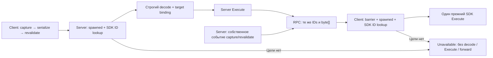

# Допуск событий корня сетевого аватара, проект v1

2026-10-14. Владелец: network. Задача: network-sync-hardening.
Статус: **проект для ревью пользователя; реализация не разрешена этим документом и не выполнена**.
Пользователь выбрал подготовку проекта в текущей задаче. Новых игровых тестов и изменений SDK/ассетов нет.

## Цель и наблюдавшийся сбой

После замены тела сервер иногда получает события прежнего аватара, которого уже нет в сети. В Windows E2E
`20261014-211134-dedicated-server-arsenal` это четыре события GhostAvatar netId224: два SetAvatarRenderMode
и SetCurrentHandPose для двух рук. Они дали шесть Error-логов при разрешении UniqueId корня/контроллера.
Повтор неизменной сборки `20261014-212454-dedicated-server-arsenal` прошёл GREEN; первый RED остаётся фактом.

Оба missing GUID восстановлены из authored GhostAvatar и netId224. Dummy есть в префабе. Сервер уже заменил
ghost при respawn; клиент отправлял события из Start/Update. Отказ происходит до reflection cache SDK80.
Трасса и пределы причинного вывода: `../reports/2026-10-14-e2e-error-diagnosis.md`.

Цель v1: корректно сформированное событие **корня сетевого аватара**, которого больше нет в локальном
Mirror.spawned получателя, не входит в SDK-декодер, не исполняется и не рассылается дальше.
Живые корни сохраняют прежнее применение и строгие ошибки повреждённого payload/неизвестных ссылок.
Это проверка текущей доступности цели, а не доказательство истории «этот ID точно retired».

Источники проекта: HEAD `80f28243c`, проверенный Assets-tree `e763c4b511df4de50b6fac177d29dbb2768e64db`,
принятая база проверки `97a320c88`. При fetch получен origin/dev `39afa05bd`; scoped diff принятой ветки
по Network, Player/Avatars, Mirror/Core и UXR/Core/StateSync пуст. Rebase и новые Unity-проверки не выполнялись.

## Выбор подхода

| Подход | Покрытие и цена | Решение для v1 |
|---|---|---|
| NetId и существующий UniqueId корня рядом с прежним SDK payload | Покрывает найденные четыре события до SDK. Mirror владеет жизнью, SDK — ID. Изменяет сигнатуры relay и добавляет проверку binding | Рекомендован |
| NetId любой ближайшей NetworkIdentity | Дополнительно меняет допуск предметов, вложенных объектов, AOI и финальных событий | Отдельное расширение после доказанной необходимости |
| Tombstones/типизированный SDK resolver | Может различать снятые ссылки внутри аргументов; требует истории, retention, SDK-контракта и общего retirement boundary | Отдельное архитектурное изменение |

V1 не добавляет lifecycle writer в AvatarManager/AvatarTeardown, SDK-патч или глобальную историю GUID.
Она дополняет существующий исходящий DespawnedObjectEventFilter; Mirror patch4 остаётся отдельной необходимой правкой.
В scope входит concrete `sourceComponent is UxrAvatar`, не synthetic IUxrStateSync wrapper с `.Component`=avatar.
Это сохраняет доказательство, что SerializeEventBinary пишет UniqueId того же самого проверенного root.

Путь собственного server-события уже применён его автором; повторного Server Execute для него нет.

## Владельцы состояния и граница жизни

- Mirror владеет netId и spawned. Проверка network берёт текущий факт из NetworkServer.spawned либо
  NetworkClient.spawned, без собственного mutable списка живых/мёртвых тел.
- Gameplay владеет заменой тела, освобождением рук/снаряжения и вызовом NetworkServer.Destroy.
  Последовательность release → Destroy сохраняется. Mirror удаляет запись spawned внутри Destroy.
- Session.ActiveAvatar не используется как критерий допуска: ReplaceBody присваивает новое тело ещё до
  окончательного освобождения и удаления прежнего. Нельзя объявить прежнее тело снятым раньше Mirror.
- SDK продолжает владеть UniqueId, разбором и исполнением StateSync, включая IsInsideStateSync.
- NetworkStateRelay остаётся единственным транспортом. Новый helper только вычисляет допуск и binding;
  состояния протокола/диагностические счётчики принадлежат экземпляру relay, не static registry.

Gameplay owner-info 7027 подтверждает отсутствие общего retirement-сигнала. Для этого варианта он не нужен.
AOI hide означает локально недоступную цель, а не окончательную смерть серверного объекта.

## Wire-контракт

Добавить uint `avatarRootNetId` и Guid `avatarRootUniqueId` к существующим CmdComponentStateChanged
и RpcComponentStateChanged. Guid копируется из существующего IUxrUniqueId.UniqueId, не генерируется заново.
Вложенный byte[] SDK сохраняется побайтно; UniqueId/binary-version/type format не копируется в network parser.
`originNetId` остаётся отдельным прежним аргументом RPC: это identity отправителя для исключения эха,
а не identity цели события.

| Значение | Значение для протокола |
|---|---|
| avatarRootNetId > 0, avatarRootUniqueId != Empty | Source component — сам UxrAvatar с UxrMirrorAvatar и NetworkIdentity на том же GameObject |
| avatarRootNetId = 0, avatarRootUniqueId = Empty | Событие вне нового scope; прежний строгий SDK-путь |
| Только одно из полей пустое | InvalidEnvelope; нет исполнения/forward |

Невыровненный/не заспавненный сетевой UxrAvatar не кодируется как 0. Его обрабатывает существующий
AvatarStateEventGate либо отправка прекращается с отдельной диагностикой недоступного source.
UxrAvatar без UxrMirrorAvatar относится к прежнему локальному/несетевому пути; новый допуск не делает его сетевым.

Сигнатуры relay меняют Mirror remote-call hash. Требуется одна согласованная сборка всех участников;
совместимость со старой сигнатурой и fallback на прежний приём без envelope не предусматриваются.
Отдельный version byte не вводится: это новая сигнатура протокола, не парсинг многоверсионного SDK payload.
Канал/правила авторства сохраняются. Фиксированные Mirror-параметры добавляют **20 байт к каждому событию**,
включая unscoped. Проверить размер прежнего SDK payload вместе с metadata относительно существующего лимита
сообщения; не допускать усечения payload. Custom codec/префикс byte[]/копирование SDK-буфера не добавляются.

Почему не только uint: такой вариант требует второго scoped decode на клиенте для независимого binding.
В текущем SDK нет execute overload для уже decoded event. Пара существующих ID позволяет проверить локальный
root до SDK и довериться серверному binding исходного неизменного payload; клиент сохраняет один decode.
Если +20 байт на поток не укладываются в измеренный бюджет, остановиться перед реализацией и отдельно
согласовать компактный формат или SDK API; не ослаблять binding. Более компактный переменный codec здесь
не выбран, чтобы не добавлять ещё одного владельца формата сериализации.
У scoped event добавляется проверочный SDK registry lookup и сравнение instance/ID. Это не нулевая CPU-цена;
в измерениях нужно отделить её от сохранённого единственного decode и трафика +20 байт.

## Отправка

1. Сохранить существующие Network-option, DespawnedObjectEventFilter, StateEventAuthority и prealignment gate.
2. Capture metadata выполняется в Send после выхода из очереди AvatarStateEventGate. Для scoped root получить
   NetworkIdentity на том же GameObject, netId > 0, выровненный CombineIdSource и запись собственного spawned,
   указывающую на **тот же экземпляр** identity. Зафиксировать его текущий UniqueId. Для остальных целей —
   точную пару 0/Guid.Empty.
3. Сериализовать событие прежним SerializeEventBinary(component).
4. Перед отправкой повторно проверить существование source и то же identity/netId/UniqueId/spawned membership.
   Убраный/сменившийся source не отправлять; уже сериализованные байты не переназначать новому телу.
5. Передать metadata и byte[] в прежнюю ветку server RPC или ready-client Command.

Identity держателя предмета, локальной сессии или Session.ActiveAvatar не подставляется вместо цели.
UxrGrabManager, оружие, карманы, UxrLocomotion и дочерние компоненты не становятся AvatarRoot scope.
В частности, живой предмет с собственной NetworkIdentity не отсекается из-за смены тела его держателя.

## Приём на сервере

Порядок обязателен:

1. Прежний guard живого точного connection instance.
2. Проверить согласованность пары metadata. Для avatarRootNetId > 0 проверить NetworkServer.spawned
   до любой SDK-десериализации. Если записи нет либо identity уничтожен, вернуть AvatarRootUnavailable;
   не вызывать SDK и не отправлять RPC. Живая identity без ожидаемого сетевого UxrAvatar root — InvalidEnvelopeBinding.
   Если root существует, его текущий IUxrUniqueId.UniqueId обязан совпасть с avatarRootUniqueId;
   иначе InvalidEnvelopeBinding, также до SDK.
   Через существующий untyped UxrUniqueIdImplementer.TryGetComponentById проверить, что этот GUID разрешается
   в **тот же экземпляр** root. Живой Mirror root с отсутствующим/неверным SDK registry mapping — отдельная
   binding/registry ошибка, а не нормальный stale drop. Registry не перезаписывать и не Register/Unregister ради допуска.
3. Выполнить существующий строгий DeserializeEventBinary. Ошибка остаётся ошибкой; список аргументов не меняется.
4. Проверить binding decoded target: при nonzero это тот же UxrAvatar/identity/netId/UniqueId, который допущен на шаге2.
   При 0 decoded target не должен оказаться сетевым UxrAvatar root. Несоответствие — InvalidEnvelopeBinding,
   без Execute/forward. Envelope не даёт права действовать и не заменяет существующую authority policy.
5. Сохранить существующий запрет client ammo-admission. Затем ExecuteStateSyncEvent(byte[]) и проверку IsError.
6. Рассылать только успешно применённое событие с той же парой root IDs, **тем же неизменным byte[]**
   и прежним originNetId.

Не добавлять проверку «sender владеет target через Mirror.owned»: действующая модель авторства предметов
не равна Mirror ownership. Эта задача не вводит новую anti-cheat/permission модель.

## Приём на клиенте

1. Сохранить прежние host skip, исключение эха по originNetId и InitialStateBarrier.
   Затем проверить согласованность всей пары, включая запрещённый случай 0/nonempty Guid.
2. При avatarRootNetId = 0 сохранить прежний ExecuteStateSyncEvent(byte[]) без дополнительного декодирования.
   Сервер обязан проверять client-origin scope/binding и формировать собственные исходящие metadata корректно.
3. При nonzero проверить согласованность пары, NetworkClient.spawned и сетевой root до SDK.
   Недоступная цель → AvatarRootUnavailable. У доступного root его текущий UniqueId должен совпасть с metadata;
   mismatch → InvalidEnvelopeBinding. Это не разрешение искать замену/новое тело.
   Тот же untyped SDK lookup обязан вернуть этот root instance; иной/отсутствующий mapping диагностируется
   как binding/registry ошибка до Execute, без исправления registry. Lookup не разбирает SDK event payload.
4. Вызвать прежний ExecuteStateSyncEvent(byte[]) один раз. SDK-ошибки остаются ошибками.

Клиент доверяет **авторитетному серверу**, который выполнил actual-target binding для входящего Command,
либо сформировал собственное событие через capture/serialize/revalidate одного source. Forward не меняет SDK
payload и metadata. При этих условиях его SDK root-ID соответствует проверенной паре; заново декодировать
payload только для повторного binding клиенту не нужно. Самостоятельный client RPC/injection и недоверенный
сервер не входят в модель доверия проекта. Потеря этой серверной проверки — нарушение контракта, а не повод
продолжить принимать старый формат или проверять только membership. Приём → lookup → Execute идёт синхронно
на main thread, без await/очереди между проверкой и SDK; повторная жизнь root не переносится в этот промежуток.

Прямой target.SyncState запрещён: он обходит SDK IsInsideStateSync и создаёт риск эха/повторных эффектов.
SDK execution API и число decode сохраняются: server — существующие два, client — существующий один.

## Порядок сообщений, смена карты и повторный вход

- Spawn, destroy и relay используют существующий reliable канал Mirror. Для одной connection порядок
  Spawn → event → Destroy сохраняется; новая очередь ожидания target spawn, TTL или retry не добавляется.
  Если клиент не наблюдает root (AOI), он не применяет его событие; счётчик недоступности не называет это retirement.
- В пределах активной Mirror server session netId выдаётся возрастающим счётчиком. В просмотренном game/editor
  коде нет ResetNextNetworkId; reset выполняется при Shutdown после остановки транспорта/очистки spawned.
  Снятое connection instance отсекается существующим guard. Старые RPC не переносятся между transport connections.
- Не вводить второй SessionEpoch/MapRunKey writer. Начальный снимок карты остаётся за прежним barrier;
  MapRunKey не навязывается persistent target. Admission/counters очищаются с lifecycle экземпляра relay.
- Reuse/reset netId в живой session или перенос payload в новый connection являются изменением этого контракта
  и требуют epoch/generation решения. Корректность такого будущего режима здесь не заявляется.
- Pooling/AOI re-show одной identity не объявляется новой gameplay-жизнью; это существующий Mirror scope.
  Новая incarnation аватара должна пройти обычный spawn, а не получить старый envelope из очереди.

## Что v1 не исправляет

Живой root с уже удалённым объектом в аргументах, события дочерних компонентов прежнего тела, произвольные
битые GUID и неверный packet scope остаются за прежним строгим декодером/отдельным решением.
Обобщение на все NetworkIdentity не вводится без проверки detach, финальных release и observers.
Событие отсутствующего avatarRootNetId не называется доказанным Retired: без истории это только Unavailable.
Нет blanket catch UxrComponentNotFoundException, возврата null/default вместо аргумента, лог-noise фильтра,
задержки Start/Update либо удержания уничтоженных компонентов в live UniqueId registry.

## Наблюдаемость и приёмка

Минимальные фиксированные счётчики на экземпляр relay: scoped received, decoder entered, unavailable,
invalid binding, scoped applied. Раздельно для server/client; без растущего словаря GUID/netId.
Для диагностики допустим один last rejected netId и ограниченный GameLog.Network.Verbose;
невозможный binding диагностируется отдельно. Счётчики не участвуют в решении о жизни объекта.

| Проверка | Наблюдаемое требование |
|---|---|
| Позднее событие прежнего сетевого root | Unavailable растёт; для него нет входа в decoder/Execute/forward |
| Живой root | Binding совпал; эффект ровно один; origin не получает эхо, host не исполняет дважды |
| Живой root с missing argument или повреждённым payload | Прежняя строгая ошибка; ноль применения/forward |
| Ошибочная пара metadata/чужой live root | Invalid binding; ноль применения/forward, client-ID mismatch до decode |
| Невыровненный root | Header создаётся после gate; нет отправки через 0 и нет подмены поколения |
| Финальное освобождение старого тела | Не отсекается сравнением ActiveAvatar; порядок release → Destroy сохранён |
| Несетевые root, предметы, ammo admission | Прежняя семантика, без новых запретов по владельцу/держателю |
| ServerOnly +2 клиента; host+client; замена тела/карта/reconnect | Действующая синхронизация сохранена, late-root rejection наблюдён отдельно |
| Стоимость | +20 байт на каждое событие; без нового decode/коллекций/строк на admission hot path при Verbose off; измерить фактический трафик/GC/CPU на player/Quest |

До пользовательской проверки изменённого gameplay: компиляция, Android gate и применимые существующие
Network/Weapons checks, затем существующий dedicated-server-arsenal и ручная смена тела через штатный UI/API.
Отчёт фиксирует SHA, роли, coverage, counters и raw logs. Отсутствие late packets в прогоне означает, что
negative branch **не наблюдалась**, а не её PASS. Дополнительные игровые тесты/изменения ожиданий — после
пользовательской приёмки, в regression-tests этой же задачи. Детерминированный тест тогда проверяет, что
reject до decode действительно не вызывает decoder/Execute/forward, а не только счётчик.

## Предлагаемая последовательность после ревью проекта

1. Пользователь оценивает узкую границу и цену +20 байт; network сверяет contract с gameplay/avatar-ik/performance.
2. После одобрения проекта — отдельный письменный план реализации и выбор способа исполнения.
3. Предлагаемые code paths: NetworkStateRelay.cs и новый pure AvatarRootEventAdmission.cs (+Unity .meta).
   SDK, Mirror, gameplay lifecycle и prefabs не меняются. Номера SDK-патчей для этого варианта не нужны.
4. До implementation — свежий rebase accepted origin/dev с сохранением локальных tools; source-review drift.
5. Unity package/cleanup подготовить заранее; FIFO/lease только на фактические проверки, finish до анализа.
6. Пользовательская проверка, затем регрессионные тесты и принятый commit/integration штатным путём.

Ни проект, ни owner review, ни существующие PASS643/658 не означают приёмку ещё не написанной правки.
